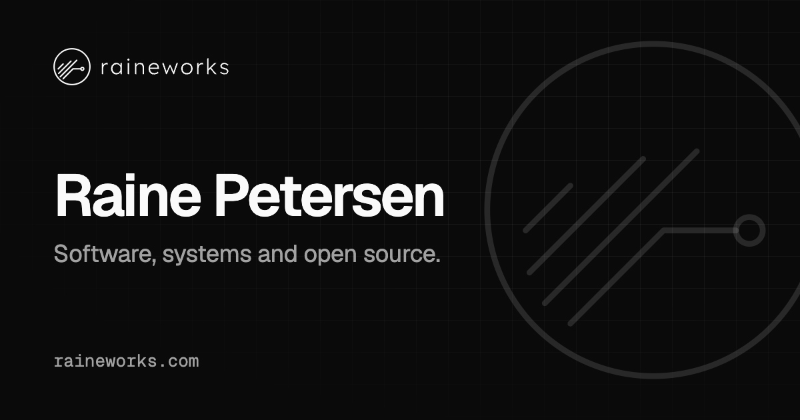

<p align="center">
  <a href="https://raineworks.com"></a>
</p>

<p align="center">
  <a href="https://github.com/raine-works/raineworks/actions/workflows/ci.yml"></a>
  <a href="https://github.com/raine-works/raineworks/releases/latest"></a>
  <a href="LICENSE"></a>
  
  
  
  <a href="https://buymeacoffee.com/raineworks"></a>
</p>

# raineworks

Raine Petersen's site: who Raine is, what Raine is building, and the projects behind it. Read it at
**[raineworks.com](https://raineworks.com)**, or in a terminal:

```bash
ssh raineworks.com
```

## How it's built

A Bun workspace. A Hono server compiles to one standalone binary with the site embedded, serving a React 19 front end
built on shadcn/ui and ui-sdk.

- **Prerendered.** Every page is rendered at build time and hydrated once it has painted, so it shows before any script
  loads. Lighthouse scores 100 in every category, on mobile and desktop.
- **Shares well.** Each page has its own title, description, canonical link and an Open Graph / X card with the site's
  share image. There's a `sitemap.xml`, a `robots.txt`, and schema.org data about Raine.
- **Live.** Each project card shows its GitHub stars, which the server asks GitHub for every ten minutes.
- **In a terminal too.** `ssh raineworks.com` is the same content as an [OpenTUI](https://github.com/sst/opentui) app,
  with its own image.

## Packages

| Package | What |
| --- | --- |
| [`@raineworks/server`](packages/server) | The Hono server: probes, `/api`, every web zone; compiled into one standalone binary |
| [`@raineworks/api`](packages/api) | The typed `hc` client over the server's routes |
| [`@raineworks/ui`](packages/ui) | The design system: tokens, shadcn components, blocks, the zone root and prerendering, About (What's new and Legal) |
| [`@raineworks/web-marketing`](packages/web-marketing) | The site itself, the `marketing` zone at `/`; its `content/profile` is what every page says |
| [`@raineworks/ssh`](packages/ssh) | `ssh raineworks.com`: the site as an OpenTUI terminal UI over an `ssh2` server, its own image |
| [`@raineworks/tools`](packages/tools) | The shared toolbox: zones, the frontend build, env, HTTP, versions, releases, licence notices |
| [`@raineworks/tsconfig`](packages/tsconfig) | The TypeScript configs every package extends |

## Getting started

Bun 1.4.4 (`.bun-version`), then:

```bash
bun install
bun run dev:init    # each package's .env.local and the SSH dev host key (safe to re-run)
bun run dev         # every package's dev server at once: the zones in watch mode, the server on
                    # http://127.0.0.1:3032, and `ssh -p 2222 localhost`
```

| Command | What |
| --- | --- |
| `bun run dev` / `dev:kill` | Develop / stop this repo's dev processes |
| `bun run build` | Every zone, the server binary (`packages/server/dist/server`) and the SSH one (`packages/ssh/dist/ssh-server`) |
| `bun run format` / `lint` / `typecheck` / `test` | `bun fmt`, `bun fmt --check`, `bun check -b`, every package's tests |
| `bun run release` | Start the next release's note |

More in [docs/development.md](docs/development.md).

## Docs

| Doc | What |
| --- | --- |
| [AGENTS.md](AGENTS.md) | The rules for changing this repo (`CLAUDE.md` links to it) |
| [STYLEGUIDE.md](STYLEGUIDE.md) | How the code reads |
| [docs/architecture.md](docs/architecture.md) | Packages, zones, the server, production |
| [docs/development.md](docs/development.md) | Running, testing, releasing, deploying, the workflows |
| [docs/frontend.md](docs/frontend.md) | Zones, the design system, prerendering and share cards, About, versions and updates |

## Releases and automation

Calendar versions, `YEAR.MONTH.N`, tagged `v<version>`. Every page shows its version in the footer; clicking it opens
What's new.

- **Releases.** A push to `master` that changes an image is a release, cut by GitHub Actions:
  `ghcr.io/raine-works/raineworks` (the site) and `ghcr.io/raine-works/raineworks-ssh`, tagged with the version and
  `latest`. Its GitHub release is written from its note in `packages/ui/src/release-notes/`, and production (Dokploy)
  is told to deploy.
- **Release notes.** When a release goes out without a note, Claude writes the next one, covering everything since the
  last note, and opens it as a pull request; merging it is that release.
- **Code review.** Claude reviews every pull request against [AGENTS.md](AGENTS.md), and follows up on its findings
  until they're fixed.
- **Docs sync.** After `master`'s CI passes, Claude fixes any doc the new commits made wrong, in a pull request.
- **@claude.** Mention `@claude` in an issue or a pull request and Claude answers there, or makes the change.
- **Protected `master`.** Every change goes through a pull request, with the checks, the review and an approval
  ([.github/rulesets/](.github/rulesets)).

## Support

If something here helped you, you can buy Raine a coffee:

<a href="https://buymeacoffee.com/raineworks"></a>

## License

[MIT](LICENSE) © Raineworks LLC. The open-source packages the site is built with, and their licences, are listed under
About → Legal on every page.
